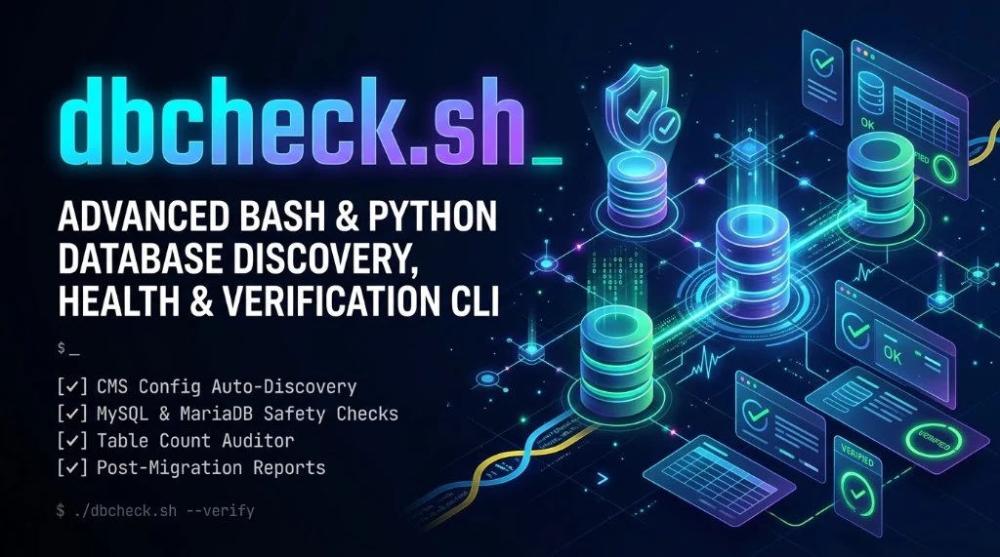

🇺🇸 **English** | [🇧🇷 Português (BR)](README-ptbr.md) | [🇪🇸 Español](README-es.md)

# dbcheck — Multi-CMS Database Config Discovery & Live Connection Auditor

[](LICENSE)
[](https://github.com/sr00t3d/dbcheck/releases)
[](dbcheck.sh)



**`dbcheck.sh`** is a zero-dependency Bash + Python 3 stdlib CLI that automatically discovers database configuration files across **10 popular CMS & PHP frameworks**, tests live MySQL/MariaDB connectivity safely (passing passwords via `MYSQL_PWD`, never on the command line), counts tables in each database, masks passwords by default, and exports `table`, `json`, and `csv` reports — ideal for post-migration verification on cPanel/WHM, Plesk, DirectAdmin, or standalone Linux servers.

> **Historical Inspiration:** Clean-room reimplementation inspired by `DB Checker 3.2` (2013, **Rishwanth Y** / HostGator Migrations). Removes the defunct internal `xfermodules.pm` / `dbconnect` Perl dependency, adds modern framework parsers (Laravel `.env`, Magento 2, PrestaShop 1.7/8, Drupal 8–11), hides passwords by default, and exports structured JSON/CSV.

---

## Supported CMS & Frameworks

| Application | Config File |
| :--- | :--- |
| **WordPress** | `wp-config.php` |
| **Laravel / Symfony / PHP** | `.env` (`DB_CONNECTION=mysql|mariadb`) |
| **WHMCS** | `configuration.php` (`$db_name`) |
| **Joomla** | `configuration.php` (`JConfig`) |
| **PrestaShop 1.7 / 8** | `app/config/parameters.php` |
| **PrestaShop 1.6** | `config/settings.inc.php` |
| **Magento 2** | `app/etc/env.php` |
| **Drupal 8–11** | `sites/default/settings.php` |
| **OpenCart** | `config.php` (`DB_DATABASE`) |
| **Moodle** | `config.php` (`$CFG->dbname`) |

---

## Direct Execution (Linux)

```bash
# Audit all CMS database connections in a web root without cloning
bash <(curl -fsSL https://raw.githubusercontent.com/sr00t3d/dbcheck/main/dbcheck.sh) -d /var/www/html --exit-code
```

---

## Installation & Usage

```bash
git clone https://github.com/sr00t3d/dbcheck.git
cd dbcheck
chmod +x dbcheck.sh

# Scan current directory or specific path
./dbcheck.sh -d /home/alice/public_html

# Show only broken DB configs and exit 2 if any fail (great for post-migration checks)
./dbcheck.sh -u alice --bad --exit-code

# Test remote MySQL fallback host during server migration
./dbcheck.sh -d /home/alice/public_html --remotehost 10.0.0.25 -o json

# Export discovered credentials to a chmod 600 file
./dbcheck.sh -d /home/alice/public_html --dump-file /root/alice-dbs.txt
```

---

## Real Output Example

```text
======================================================================================
 dbcheck.sh v2.0.0 | Multi-CMS Database Connection Auditor | 2026-11-21T07:56:10Z
======================================================================================
[OK]   WordPress      dbcheck_e2e_db     user=dbcheck_e2e_usr host=localhost    tables=2
       file: /tmp/dbcheck-e2e/wp/wp-config.php
[OK]   Laravel/.env   dbcheck_e2e_db     user=dbcheck_e2e_usr host=127.0.0.1    tables=2
       file: /tmp/dbcheck-e2e/laravel/.env
[FAIL] WHMCS          dbcheck_e2e_db     user=dbcheck_e2e_usr host=127.0.0.1    ERROR 1045 (28000): Access denied...
       file: /tmp/dbcheck-e2e/whmcs/configuration.php

Summary: 3 config(s) | 2 OK | 1 FAIL
Dumped : /tmp/dbcheck-dump.txt (chmod 600)
# Exit code: 2
```

---

## Author & License

Developed by **Percio Castelo** ([perciocastelo.com.br](https://perciocastelo.com.br)).
Inspired by `DB Checker 3.2` (2013, **Rishwanth Y** / HostGator Migrations).

Licensed under the [Apache License 2.0](LICENSE).
